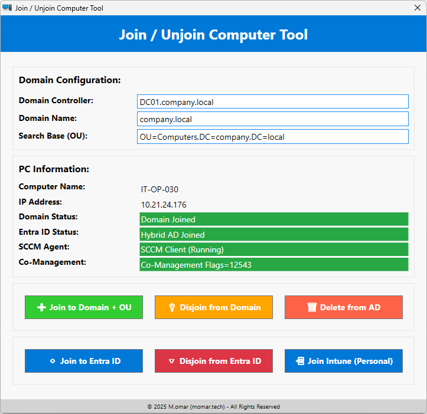
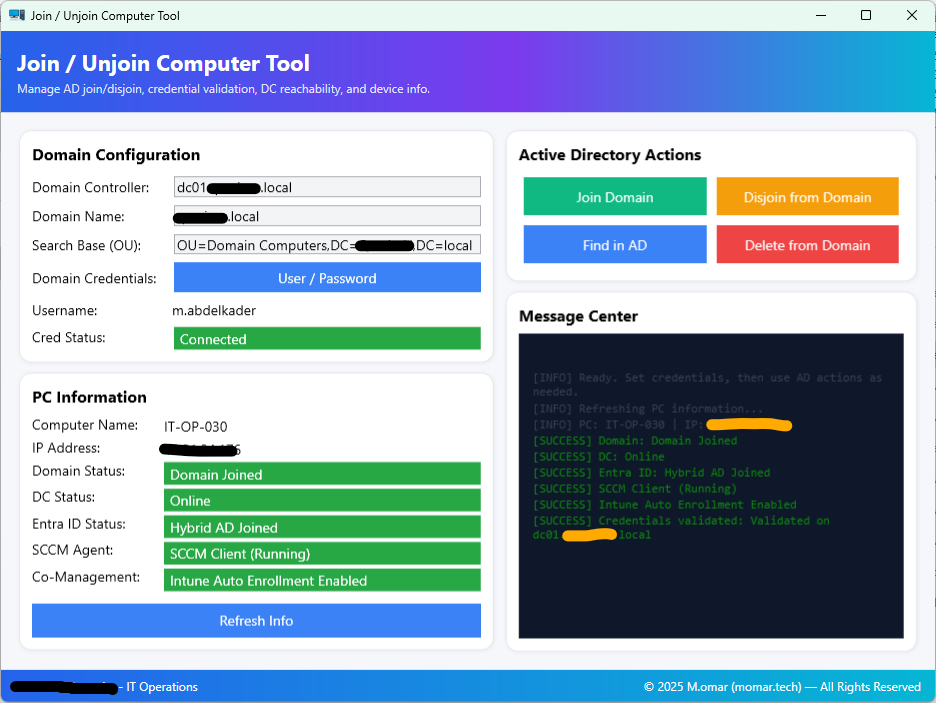

<div align="center">

# 🖥️ Join Unjoin Computer Tool

**WPF GUI for join, disjoin, and cleanup of computer objects in AD and Entra ID**

A small helpdesk window for domain joins, OU selection, AD object deletion, and device status. It turns common PowerShell steps into buttons with clear status colors.

[](#%EF%B8%8F-usage)
[](#%EF%B8%8F-usage)
[](https://learn.microsoft.com/en-us/powershell/)
[](#%EF%B8%8F-requirements)
[](#-license)
[](#-overview)

[Overview](#-overview) • [Features](#-core-features) • [Structure](#-project-structure) • [Usage](#%EF%B8%8F-usage) • [Parameters](#%EF%B8%8F-parameters) • [Requirements](#%EF%B8%8F-requirements) • [License](#-license)

</div>

---

# 📖 Overview

Join Unjoin Computer Tool is a PowerShell WPF window for everyday computer object work in Active Directory, Entra ID, and Intune. It handles domain join and disjoin with OU selection, deletion of AD computer accounts, Entra ID join and leave, Intune enrollment, and a live snapshot of device status. Confirmation prompts and colored status indicators keep the risky steps visible.

Two builds ship together. Version 1 (Classic, 2.1.0) includes Intune personal-device enrollment and a broader set of dialogs. Version 2 (Enhanced, 2.5.0) adds credential validation, domain controller reachability checks, and a Message Center with a copyable log. Use v2 for normal support work.

### 🖼️ Screenshots



*Version 1, the Classic build.*



*Version 2, with the Message Center and credential status.*

---

# ✨ Core Features

### 🔹 Domain Join and Disjoin
* Join a computer to AD by picking an OU and supplying credentials
* Disjoin a machine and place it in a workgroup, with a restart prompt

### 🔹 AD Object Deletion
* Version 1 can delete inactive or unwanted computer accounts and warns when the account is still enabled
* Version 2 only allows deletion when the computer account is disabled

### 🔹 Entra ID and Intune
* Join or leave Microsoft Entra ID with `dsregcmd`
* Version 1 can also start Intune enrollment for a personal device

### 🔹 Device Information Snapshot
* Shows domain state, IP address, Entra join state, SCCM client, and co-management status
* A refresh button updates the values

### 🔹 Helpdesk Safety
* Colored status indicators for Active, Inactive, and Needs Attention
* Version 2 validates credentials and checks the domain controller on ports 389 and 88
* Version 2 logs actions in a Message Center with Copy All and Clear

---

# 📂 Project Structure

```text
JoinUnjoinComputerTool/
│
├── JoinUnjoinComputerTool-v1.ps1     # Classic build, version 2.1.0
├── JoinUnjoinComputerTool-v1.exe     # Compiled v1
├── JoinUnjoinComputerTool-v2.ps1     # Enhanced build, version 2.5.0
├── JoinUnjoinComputerTool-v2.exe     # Compiled v2
├── Screenshot1.png
├── Screenshot2.png
└── README.md
```

---

# 🚀 Getting Started

### Prerequisites
* Windows 10/11 or Windows Server 2016 and later
* PowerShell **5.1** with WPF
* An elevated session. Domain membership changes need administrator rights

### Installation

1. Download `JoinUnjoinComputerTool-v2.ps1` unless you need the Classic build
2. Run it from an elevated PowerShell session:

```powershell
.\JoinUnjoinComputerTool-v2.ps1
```

3. Or start `JoinUnjoinComputerTool-v2.exe`, which needs no execution policy change

### Typical Workflow

1. Review the device information panel
2. Join or disjoin the computer, or delete a computer object
3. Use the Entra ID controls if the device needs registration changes
4. Refresh the device panel to confirm the result

### Parameters

Both scripts accept the same three parameters. Defaults differ by build.

| Parameter | Type | v1 default | v2 default | Description |
|-----------|------|------------|------------|-------------|
| `DefaultDomainController` | String | `DC01.company.local` | `dc01.example.local` | Domain controller used for AD queries |
| `DefaultDomainName` | String | `company.local` | `example.local` | Domain used for joins and disjoins |
| `DefaultSearchBase` | String | `OU=Computers,DC=company,DC=local` | `OU=Domain Computers,DC=example,DC=local` | OU used as the join target |

```powershell
.\JoinUnjoinComputerTool-v2.ps1 -DefaultDomainController "dc02.contoso.local" -DefaultDomainName "contoso.local"
```

The tool is a GUI and has no exit code contract. It ends when you close the window.

---

# ⚙️ Requirements

### Operating System
* Windows 10 / Windows 11 / Windows Server 2016 and later

### PowerShell
* Windows PowerShell **5.1** with WPF (`PresentationFramework`)

### Modules and Permissions
* Version 1 loads the `ActiveDirectory` module for domain operations
* Version 2 uses `System.DirectoryServices.AccountManagement`
* Administrator rights on the local machine, plus AD rights to join, disjoin, and delete computer objects
* Entra ID device registration needs an account allowed to register devices
* The SCCM client is only needed to display co-management status

---

## 🧰 Core Commands

| Command | Purpose | Docs |
|---|---|---|
| `Add-Computer` | Joins the machine to the domain with OU selection | [Microsoft Docs](https://learn.microsoft.com/en-us/powershell/module/microsoft.powershell.management/add-computer) |
| `Remove-Computer` | Disjoins the machine and places it in a workgroup | [Microsoft Docs](https://learn.microsoft.com/en-us/powershell/module/microsoft.powershell.management/remove-computer) |
| `Get-CimInstance` | Reads `Win32_ComputerSystem` for domain and device state | [Microsoft Docs](https://learn.microsoft.com/en-us/powershell/module/cimcmdlets/get-ciminstance) |
| `dsregcmd` | Joins or leaves Entra ID and reports join state | [Microsoft Learn](https://learn.microsoft.com/en-us/entra/identity/devices/troubleshoot-device-dsregcmd) |

---

# 🛡 Operational Notes

* Use v2 for daily support. Keep v1 only when you need its Intune enrollment dialog or are debugging it
* Give the helpdesk account only the OU rights it needs. Domain Admin should not be the default
* Deleting an AD object cannot be undone. Check the name twice before confirming
* If a script is blocked, run `Set-ExecutionPolicy -Scope Process -ExecutionPolicy Unrestricted -Force`, or use the `.exe` build
* For Entra ID failures, check the network and run `dsregcmd /status` by hand. For co-management issues, inspect the `CoManagementFlags` registry value

---

## 👤 Author

**Mohammad Abdelkader Omar**  
GitHub: [@mabdulkadr](https://github.com/mabdulkadr)  
Website: [momar.tech](https://momar.tech)

---

## 📜 License

This project is licensed under the [MIT License](https://opensource.org/licenses/MIT).

---

## ⚠ Disclaimer

This skill and every script it generates are provided as-is with no warranty of any kind. Test generated tools in a staging environment before deploying to production. The authors assume no liability for any damage or data loss resulting from their use.

## Running the GUI and building an EXE

This repository ships source scripts only. Run `Run-GUI.bat` from File Explorer, or start the `.ps1` file from an elevated PowerShell session. If you need a standalone executable, convert the script with [PSWrap](https://github.com/mabdulkadr/PSWrap) and re-sign the result on your own machine. Prebuilt EXEs are no longer committed.

---
---
<div align="center">

⭐ **If this skill saves you time, star the repo — it helps others find it.**

[Report an Issue](../../issues) · [momar.tech](https://momar.tech)

[](https://www.buymeacoffee.com/mabdulkadrx)

Built with [**PowerShell Enterprise Admin**](https://github.com/mabdulkadr/powershell-enterprise-admin)

</div>
